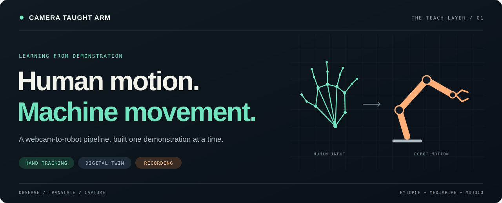
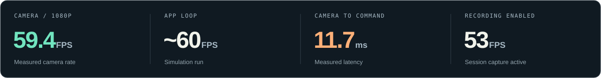
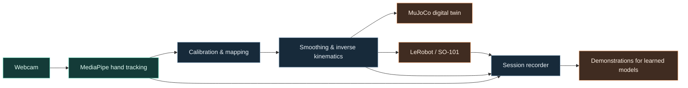

<p align="center">
  
</p>

<p align="center">
  <strong>A webcam. Your hands. A new way to teach robots.</strong><br>
  Track human motion, drive a digital twin, and record demonstrations for robot learning.
</p>

<p align="center">
  <a href="#quick-start"><strong>Quick start</strong></a> &nbsp; / &nbsp;
  <a href="#how-it-works">The pipeline</a> &nbsp; / &nbsp;
  <a href="#project-map">Explore the code</a> &nbsp; / &nbsp;
  <a href="#notes--presentation-material">Lab notes</a>
</p>

---

## Human skill, captured.

A PyTorch class project exploring how everyday webcam motion can become robot demonstrations. The current **teach layer** uses MediaPipe, geometry, inverse kinematics, and a MuJoCo digital twin. It provides the teacher and baseline for the planned learned models.

<table>
<tr>
<td width="33%" valign="top">
<strong>01 / Observe</strong><br><br>
Hand landmarks from an ordinary webcam, with a live tracking dashboard.
</td>
<td width="33%" valign="top">
<strong>02 / Translate</strong><br><br>
Calibration, smoothing, and inverse kinematics turn movement into joint targets.
</td>
<td width="33%" valign="top">
<strong>03 / Capture</strong><br><br>
Numbered takes preserve demonstrations and tracking status for later training.
</td>
</tr>
</table>

<p align="center">
  <code>Python 3.12</code> &nbsp; <code>PyTorch</code> &nbsp; <code>MediaPipe</code> &nbsp;
  <code>MuJoCo</code> &nbsp; <code>LeRobot</code> &nbsp; <code>SO-101</code>
</p>

## From the workbench



<sub>Recorded October 17, 2026 · Webcam/simulation smoke test · See the <a href="docs/notes/LAB_NOTEBOOK.md">lab notebook</a> for conditions and limitations.</sub>

**Built:** tracking, calibration, smoothing, inverse kinematics, the digital twin, dashboard, robot I/O, and session recording. The lab notebook records **81 passing automated tests** from that build.

**Next:** physical-arm alignment and validation, demonstration collection, and learned models evaluated against the classical baseline.

## Quick start

Open `C:\Users\trayd\dev\camera-taught-arm` in VS Code. Use a terminal in the project root with **uv**, **Python 3.12**, and a webcam available.

### 1. Install dependencies and the hand-tracking model

```powershell
uv sync
uv run python scripts/download_models.py
```

### 2. Launch the simulated mirror

```powershell
uv run cta-mirror
```

The default runs with `--robot none`. Place your hand at the home position and press **C** to calibrate.

| <kbd>C</kbd> | <kbd>S</kbd> | <kbd>R</kbd> | <kbd>Q</kbd> |
| :---: | :---: | :---: | :---: |
| Calibrate | Toggle smoothing | Start / stop a take | Quit |

On Windows, click the **terminal** first so it receives the hotkeys. Recording must be enabled for **R** to work.

### 3. Record a demonstration

```powershell
uv run cta-mirror --record demo
```

Calibrate, then press **R** to start or stop each take. Sessions are saved under `CTA_DATA_DIR/sessions/` with numbered take names.

<details>
<summary><strong>More launch options</strong></summary>

```powershell
# Select a camera and track the left hand
uv run cta-mirror --camera 0 --hand left

# View all options, including physical-arm and paired modes
uv run cta-mirror --help
```

Physical-arm mode requires a follower serial port and a verified `sim_real_map.json`. See the [alignment utility](src/cta/apps/sim_real_check.py) and [design document](docs/specs/2026-10-16-camera-taught-arm-design.md) before using hardware.

</details>

## How it works



The dashboard shows the live tracking and arm state. The recorder captures demonstrations for later training; the planned PyTorch models will be evaluated against the classical teach layer.

## Project map

| Where | What lives there |
| :--- | :--- |
| [`src/cta/`](src/cta/) | Tracking, mapping, filtering, kinematics, simulation, dashboard, robot I/O, and recording |
| [`src/cta/apps/mirror.py`](src/cta/apps/mirror.py) | Main app behind `uv run cta-mirror` |
| [`tests/`](tests/) | Automated checks for the core pipeline |
| [`scripts/`](scripts/) | Model download and Hugging Face data sync |
| [`docs/specs/`](docs/specs/) · [`docs/plans/`](docs/plans/) | System design and implementation plans |
| [`reports/`](reports/) · [`research_notes/`](research_notes/) | Research reports and supporting notes |

## Notes & presentation material

| Document | What you’ll find |
| :--- | :--- |
| [Engineering decisions](docs/notes/DECISIONS.md) | What was chosen and why |
| [Lab notebook](docs/notes/LAB_NOTEBOOK.md) | Experiments, bugs, measured results, and lessons |
| [Deck notes](docs/notes/DECK_NOTES.md) | Talking points for the course and client decks |
| [Approved design](docs/specs/2026-10-16-camera-taught-arm-design.md) | System design and project direction |
| [Plan 1: teach layer](docs/plans/2026-10-16-teach-layer-core.md) | Build plan for the core system |
| [Webcam motion capture research](reports/Webcam%20motion%20capture%20for%20robotics.md) | Research report with ten project ideas |
| [Raw research notes](research_notes/) | Supporting sources and findings |

## Data & models

Large files live outside the repository. `CTA_DATA_DIR` defaults to:

```text
C:\Users\trayd\dev\cta-data
```

This holds the hand-tracking model, recordings, calibration files, and future trained networks.

<details>
<summary><strong>Sync with private Hugging Face repositories</strong></summary>

```powershell
# Authenticate once per machine
uv run hf auth login

# Pull before recording on another machine
uv run python scripts/sync_data.py pull

# Upload completed takes between recording sessions
uv run python scripts/sync_data.py push --what sessions
```

Use `--what models`, `--what config`, or `--what all` to select other sync targets. Sync completed takes between recordings.

</details>

## Run the tests

```powershell
uv run pytest -v
```

---

<p align="center">
  <strong>Observe &nbsp; / &nbsp; Translate &nbsp; / &nbsp; Capture</strong><br>
  <sub>Human motion is the starting point.</sub>
</p>
